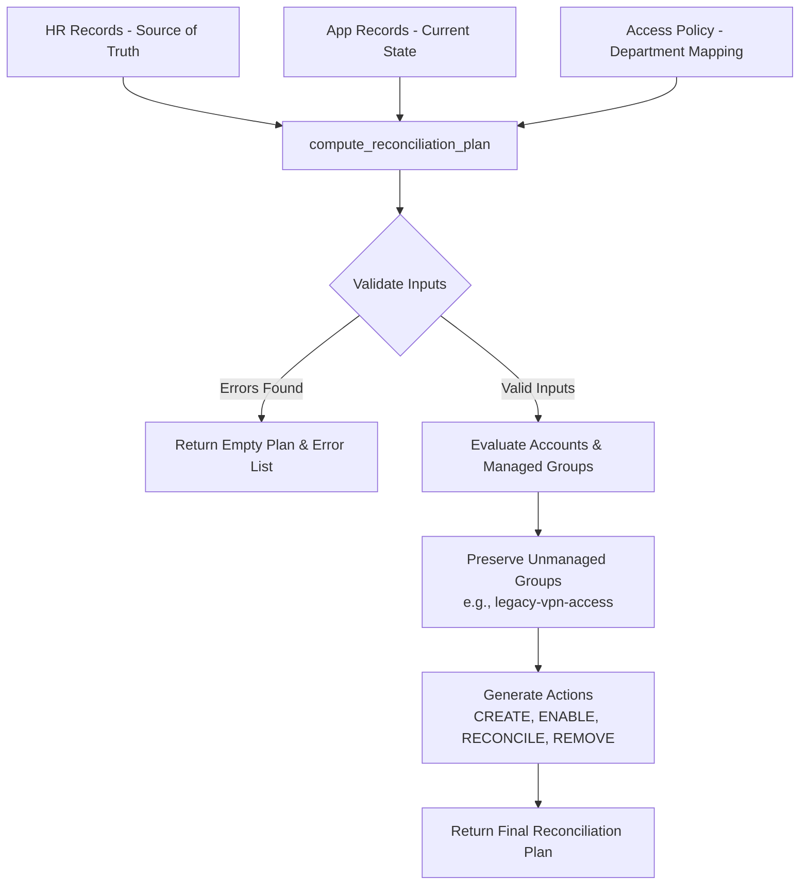

# Identity-Reconciler

A modular Python tool designed to reconcile HR identity data against active application accounts based on predefined access policies. It ensures strict compliance with departmental roles while preserving unmanaged and legacy group memberships.

---

## 🛠️ Architecture & Workflow

The diagram below illustrates how the engine ingests records, validates inputs, evaluates policy constraints, and computes the reconciliation plan.



---

## 🚀 Getting Started

### Prerequisites

* Python 3.10+ (tested on Python 3.14)
* `pytest` for running unit tests

### Installation

1. Clone the repository:
   ```bash
   git clone https://github.com/bouttg/Identity-Reconciler.git
   cd Identity-Reconciler
   ```

2. Install dependencies:
   ```bash
   pip install -r requirements.txt
   ```

---

## 🧪 Running Tests & Execution

Run the test suite using `pytest`:
```bash
py -m pytest -v
```

Run the example script:
```bash
py main.py
```

---

## 📋 Core Principles

1. **HR as Source of Truth**: Employee status (`active`/`inactive`) dictates whether an application account should be enabled or created.
2. **Managed vs. Unmanaged Groups**:
   - **Managed Groups**: Governed strictly by departmental policies (e.g., `retail`, `finance`).
   - **Unmanaged Groups**: Preserved automatically for active users (e.g., `legacy-vpn-access`).
3. **Strict Input Validation**: Validates duplicate IDs across datasets and ensures all active employees belong to mapped policy departments.